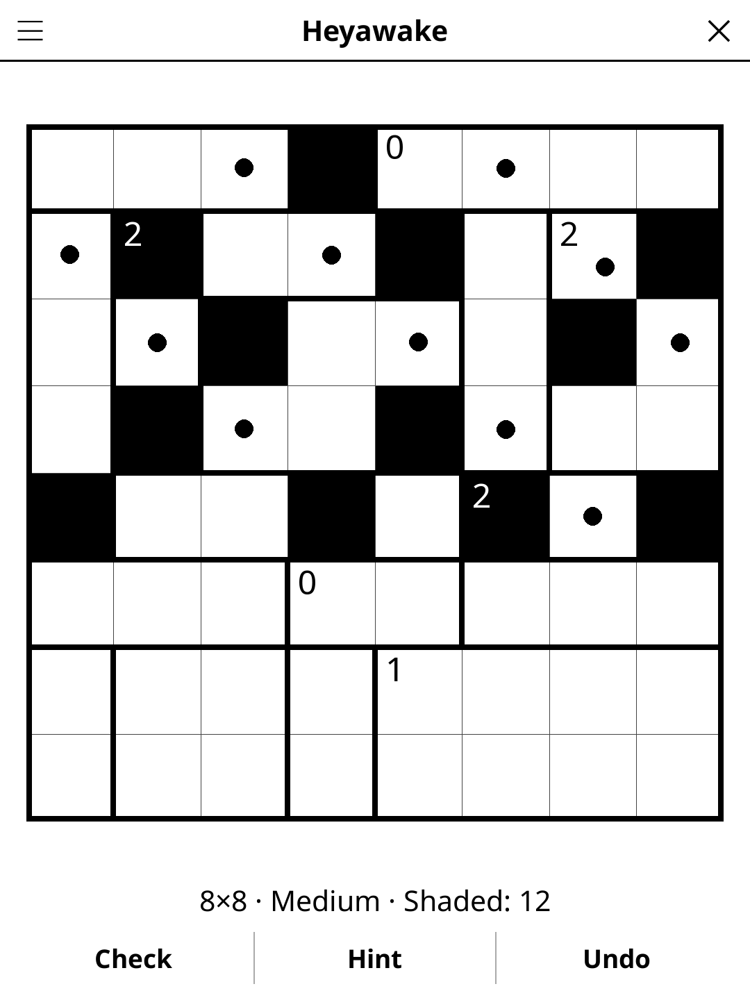

# heyawake.koplugin

A Heyawake plugin for [KOReader](https://github.com/koreader/koreader).

## Screenshot

## Rules

The grid is divided into rectangular rooms by thick walls. Shade some cells
so that:

1. A room with a number contains exactly that many shaded cells. Rooms
   without a number may hold any count.
2. Shaded cells never touch side by side (corners are fine).
3. All unshaded cells form one orthogonally connected area.
4. No horizontal or vertical line of unshaded cells crosses more than one
   wall, i.e. spans three rooms.

## Features

- **Three sizes** — 6×6, 8×8, 10×10
- **Three difficulty levels**, defined by the logic a puzzle needs:
  - *Easy* — counting, no touching shades, the three-room rule, and keeping
    the white cells connected;
  - *Medium* — also one room analysis (every way of placing a room's shades
    agrees on a cell);
  - *Hard* — several room analyses (at least 2 on 6×6, 3 on 8×8 and
    10×10), with rooms of up to 16 cells.
  No level ever needs a guess ("if this cell were shaded, something
  breaks").
- **Unique solution, every time** — each puzzle is generated together with a
  logic solver that must finish it within the difficulty's techniques, which
  proves there is exactly one solution
- **Tap to cycle** — empty → shaded → dot → empty; hold to clear. Dots are
  optional notes: the puzzle is solved as soon as the shading is right
- **Check** — crosses out wrong marks and counts rule breaks
- **Hint** — two taps: the first frames a cell you can deduce from what is on
  the board (a mistake is always reported first), the second fills it in
- **Show solution**, **Undo**, timer, auto-save and restore

## Controls

| Action | How |
|--------|-----|
| Shade / dot / clear a cell | Tap it (cycles) |
| Clear a cell | Hold it |
| Undo last move | **Undo** |
| Check progress | **Check** |
| Get a hint | **Hint** (twice to fill it in) |
| New game, size, difficulty, solution, rules | Title-bar menu |

## How the puzzles are made

Random rectangular rooms, then a random valid shading (a randomised search
using the solver's own propagation, which branches first where a three-room
line is closest to running out of cells, and gives up early for a fresh room
layout rather than wander). Every room gets its number; where the solver
still cannot finish, the room of an undecided cell is cut in two. Needless
walls are then merged away and numbers removed one by one, each change kept
only if the solver still finishes at the chosen difficulty with the right
amount of room analysis (Hard never takes a removal that lowers it).

Over 50 seeds per size and level on a desktop (LuaJIT), 10×10 takes
0.01–0.035 s on average and at most about 0.1 s (medium and hard). A Kobo is much
slower, so a progress bar appears whenever generation runs longer than a
fraction of a second.
Generation depends only on the random seed — node and attempt budgets, never
the clock — so the Daily Challenge is the same grid on every device.

## License

GPL-3.0
